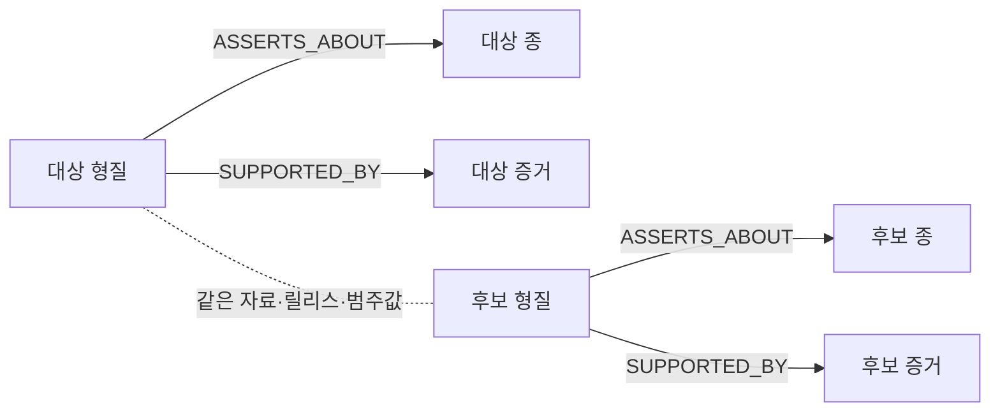

# RG-201 — 그래프 생태 관계 탐색

> 자동 증류 초안 · 원천 [[Work/RobinGraph/작업기록/2xx 검색·RAG·그래프 질의/2026-10-05-RG003-생태관계탐색-NAS배포]] · 분류 근거 {"인프라":0,"자동화":1,"관측성":0,"데이터":5}

## 1. 개요 및 목적

**요청 범위 정정 (2026-10-05)**: 이 기록의 생태 탐색 버튼 구현은 보조 기능이다. 사용자의 요구는 ‘왜가리는 무엇을 먹고 사니?’, ‘청둥오리와 비슷한 종은 어떤게 있니?’ 같은 자연어 질문에 그래프를 조회해 직접 답하는 기능이었다. 버튼 추가만으로 RG-201을 완료 처리했던 범위 해석을 정정한다. 후속 자연어 질문 처리·직접 답변·NAS TEST 검증은 [[Work/RobinGraph/작업기록/2xx 검색·RAG·그래프 질의/2026-10-05-RG003-자연어질문-그래프답변-NAS배포|자연어 질문별 그래프 답변·실환경 검증]]에서 확인한다. 아래 구현·수치·배포 이력은 당시 생태 탐색 작업의 기록으로 보존한다.

- 새 API `/v1/taxa/ecological-related`가 활성 분류판의 종을 조회하고, 출처가 있는 `habitat`·`trophic_niche` 형질을 공유하는 종을 탐색한다.
- 현재 두 범주는 기존 n8n AVONET 수집 데이터가 제공한다. PostgreSQL 활성 자료·개념집합·분류 릴리스를 확인하고, 양쪽 형질의 자료 ID·릴리스·원문 분류값을 일치시킨다. 양쪽 증거는 허용 상태와 원본 행 ID를 확인하며 추론된 형질은 제외한다.
- 분류값을 공유하는 관계를 조회 시 도출한다. 계통적 근연성이나 실제 공존·포식 관계로 주장하거나 그래프에 새 관계를 추측해 저장하지 않는다.
- 설명창의 **같은 서식 환경·먹이 생태의 새 살펴보기** 버튼에서 대상 범주·후보를 확인한다. 카드 안에는 넣지 않았다.
- 후보별 비교는 별도 답변 말풍선에 두 종 설명·카드를 제공하며, 대상 범주와 후보 출처·자료 버전·라이선스를 토글로 확인할 수 있다.
- 한국어 이름을 우선하고 없으면 영어 이름을 표시한다. 자료 없음·조회 실패·분류판 변경·대화 초기화 뒤 늦은 응답을 처리한다.
- 각 범주 최대 12종, 종별 중복 제거와 추가 결과 안내. 목록은 한국어 이름이 있는 종을 우선해 이름순으로 표시한다.

## 2. 핵심 아키텍처 및 원칙

- 구현과 근거
- 검증
- 배포
- 상세 보완 — 2026-10-05
- 조회 흐름과 그래프 경로
- 어떤 관계를 찾는가
- 응답 필드와 제한
- 실패·빈 결과·변경 대응
- 자연어 질문 처리 보완

## 3. 재사용 가능한 코드 스니펫 / 설정

## 4. 검증 근거 및 트러블슈팅

**요청 범위 정정 (2026-10-05)**: 이 기록의 생태 탐색 버튼 구현은 보조 기능이다. 사용자의 요구는 ‘왜가리는 무엇을 먹고 사니?’, ‘청둥오리와 비슷한 종은 어떤게 있니?’ 같은 자연어 질문에 그래프를 조회해 직접 답하는 기능이었다. 버튼 추가만으로 RG-201을 완료 처리했던 범위 해석을 정정한다. 후속 자연어 질문 처리·직접 답변·NAS TEST 검증은 [[Work/RobinGraph/작업기록/2xx 검색·RAG·그래프 질의/2026-10-05-RG003-자연어질문-그래프답변-NAS배포|자연어 질문별 그래프 답변·실환경 검증]]에서 확인한다. 아래 구현·수치·배포 이력은 당시 생태 탐색 작업의 기록으로 보존한다.

- 새 API `/v1/taxa/ecological-related`가 활성 분류판의 종을 조회하고, 출처가 있는 `habitat`·`trophic_niche` 형질을 공유하는 종을 탐색한다.
- 현재 두 범주는 기존 n8n AVONET 수집 데이터가 제공한다. PostgreSQL 활성 자료·개념집합·분류 릴리스를 확인하고, 양쪽 형질의 자료 ID·릴리스·원문 분류값을 일치시킨다. 양쪽 증거는 허용 상태와 원본 행 ID를 확인하며 추론된 형질은 제외한다.
- 분류값을 공유하는 관계를 조회 시 도출한다. 계통적 근연성이나 실제 공존·포식 관계로 주장하거나 그래프에 새 관계를 추측해 저장하지 않는다.
- 설명창의 **같은 서식 환경·먹이 생태의 새 살펴보기** 버튼에서 대상 범주·후보를 확인한다. 카드 안에는 넣지 않았다.
- 후보별 비교는 별도 답변 말풍선에 두 종 설명·카드를 제공하며, 대상 범주와 후보 출처·자료 버전·라이선스를 토글로 확인할 수 있다.
- 한국어 이름을 우선하고 없으면 영어 이름을 표시한다. 자료 없음·조회 실패·분류판 변경·대화 초기화 뒤 늦은 응답을 처리한다.
- 각 범주 최대 12종, 종별 중복 제거와 추가 결과 안내. 목록은 한국어 이름이 있는 종을 우선해 이름순으로 표시한다.

- Python 전체 515건: 실패 없음, 외부 DB 연동 32건은 설정에 따라 제외. 새 API·조회 테스트 5건 포함.
- 프런트엔드 117건 전부 통과. 출처·영어 이름·별도 말풍선·재시도·분류판/ID 변경·늦은 응답 검증.
- 커밋 후 NAS 릴리스 패키지 테스트 10건 재검증, 전부 통과.
- 실제 NAS 그래프: 청둥오리·왜가리·해오라기·대륙검은지빠귀 각 두 범주의 12개 후보, 총 96개 형질을 개별 조회해 같은 자료·릴리스·원문 범주·추론 제외를 대조했다. 최초 범주 조회 약 0.4~0.8초.
- 실제 배포 API: `v2025b`, `rg:concept-set:avilist-v2025b`, 허용된 AVONET 출처·동일 릴리스·후보 중복 없음, OpenAPI에 새 경로 포함 확인.
- Chromium 320·390·1280px: 습지·수생동물 포식 탐색, 출처 토글, 별도 비교 말풍선, 카드 두 개·뒤집기·연속 질문 확인. 가로 넘침·페이지 오류 없음.
- `Trochilus polytmus`의 꽃꿀 섭식 후보에서 `Akohekohe`, `Allen's Hummingbird`의 영어 이름 표시와 실제 비교 말풍선도 확인했다.
- GPT-6.1-sol이 UI와 자동 테스트를 구현하고 GPT-6-sol이 그래프 스키마·출처 정책과 최종 백엔드를 독립 검토했다. Codex가 백엔드·API·문서·통합 테스트·배포와 실환경 검증을 수행했다.
- graphify AST 업데이트 완료.

- 실제 배포 커밋: `7f1d421e4d1b620e1bdee69d2e543fad92930453` (`dev`, GitHub push 완료)
- NAS TEST 이미지: `robingraph-api:test-ecology-7f1d421`
- 배포 경로: `/home/kimdove/RobinGraph-ecology-7f1d421`
- 전송 아카이브 SHA-256: `12ffefd868243d2d715305e7ddb234dd2351b43d2d673ff4201e9ea62722d6c2`, NAS와 일치·내부 파일 manifest 검증
- API health 정상. PROD 변경 없음.
- README·조회 정책 갱신. Obsidian 작업 기록과 RG-201 완료 상태도 같은 범위로 반영한다.

| 대상 종 | 실제 확인한 서식 환경 | 실제 확인한 먹이 생태 |
|---|---|---|
| 청둥오리 | 습지 | 수생 초식 |
| 왜가리 | 습지 | 수생동물 포식 |
| 해오라기 | 습지 | 수생동물 포식 |
| 대륙검은지빠귀 | 숲 | 잡식 |

## 5. 관련 Dev 가이드

- 원천 작업기록 [[Work/RobinGraph/작업기록/2xx 검색·RAG·그래프 질의/2026-10-05-RG003-생태관계탐색-NAS배포]]
- [[Dev/index|Dev 인덱스]]
