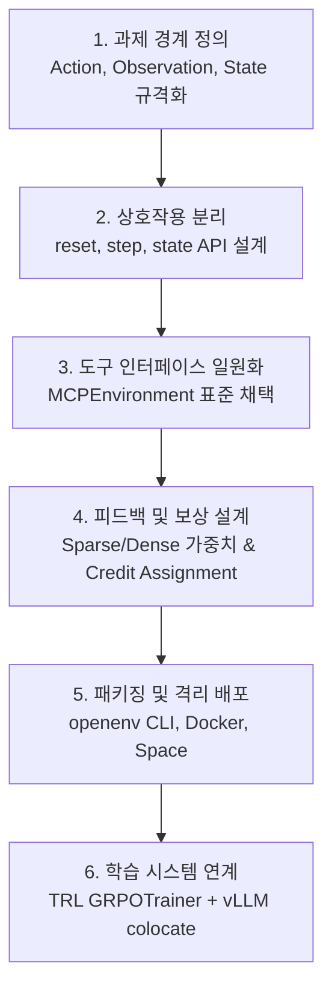

# OpenEnv와 TRL을 활용한 에이전트 강화학습 환경 구축 및 실무 적용 가이드

> [!abstract] 개요
> 본 문서는 PyTorchKR에 게재된 OpenEnv의 AAIF(Linux Foundation) 합류 및 TRL 강화학습 파이프라인 구축 글을 바탕으로, **실무 에이전트 개발, 평가 인프라 구축, 보상 설계 함정 방지 및 하드웨어 스펙 산정** 관점에서 분석·정리한 심층 학습노트입니다.
> 원문 보관본: [[Learning/원문/2026-10-24-OpenEnv-AAIF-합류-과제정의부터-TRL학습-원문|OpenEnv AAIF 프로젝트 합류 및 TRL 학습 원문]]

---

## 1. OpenEnv 생태계 및 표준화 배경

### 1.1 프로젝트 개요
* **발족**: 2025년 10월 PyTorch Conference에서 Hugging Face와 Meta-PyTorch의 공동 프로젝트로 시작.
* **재단 합류**: 2026년 10월 22일, Linux Foundation 산하 **Agentic AI Foundation (AAIF)** 의 공식 Growth 단계 프로젝트로 호스팅 발표 (공동 메인테이너: Hugging Face, Reflection, Meta, Microsoft 등 10개 조직).
* **목적**: 강화학습(RL) 학습 시스템(TRL, SkyRL, Axolotl 등)과 에이전트 하네스(Agent Harness, Goose 등), 그리고 다양한 과제 환경(Calendar Gym, Wordle, FinQA, Pelican SVG 등)을 일관되게 연결하는 **표준화된 환경 인터페이스(Standardized Environment Interface)** 제공.

### 1.2 핵심 아키텍처 원칙: 클라이언트-서버 분리
* **Client**: 에피소드 초기화(`reset`), 행동 제출(`step`), 상태 조회(`state`) API 제공 (동기/비동기 지원).
* **Environment Server**: 실제 과제 로직 실행, 보상 계산, 상태 전이, Docker/Space 기반 샌드박스 격리.
* **표준 프로토콜 결합**: 오케스트레이션 및 에피소드 라이프사이클은 WebSocket(`/ws`), 도구 명세 및 실행은 **Model Context Protocol (MCP, `/mcp`)** 을 표준으로 채택하여 학습 환경과 실서비스 배포 환경 간의 인터페이스 불일치를 해소.

---

## 2. 에이전트 학습 환경 구축 6단계 파이프라인



### Step 1. 과제의 경계 정의
* 에이전트가 수행 가능한 행동 집합(Action Space)과 관찰 가능한 정보(Observation Space), 에피소드 완료/종료 조건(Termination Condition)을 엄격히 타입화(`Pydantic` 모델 기반).
* 예: Wordle 과제의 5글자 추측 제출, Calendar Gym의 특정 권한 기반 일정 조회/생성.

### Step 2. 상호작용과 과제 로직의 분리
* 과제 내부 비즈니스 로직(채점 알고리즘, 데이터베이스 쿼리 등)을 `reset()`, `step()`, `state()` 세 가지 표준 상호작용 API 뒤로 은닉.
* 동기/비동기 클라이언트 일관성: `AutoEnv.from_env(...)`를 통해 동일 코드베이스에서 비동기(`async with`) 및 동기(`with ...sync()`) 모드 지원.

### Step 3. 도구 인터페이스 일원화 (MCP 활용)
* **이중 엔드포인트 아키텍처**:
  - **WebSocket (`/ws`)**: 학습 시스템(Trainer) 전용. 에피소드 제어, 보상 계산, 스텝 제한 관리.
  - **JSON-RPC (`/mcp`)**: 에이전트 전용. `tools/list`, `tools/call` 등 표준 도구 인터페이스 제공.
* **도구 오류 타입의 정형화**: 에이전트의 잘못된 호출과 시스템 실패를 명확히 구분하는 5가지 에러 타입 제공.
  1. `TOOL_NOT_FOUND`: 등록되지 않은 도구 호출
  2. `INVALID_ARGS`: 스키마 불일치 파라미터 제출
  3. `EXECUTION_ERROR`: 도구 실행 중 발생한 예외
  4. `TRANSPORT_ERROR`: 네트워크 및 프로토콜 통신 실패
  5. `TIMEOUT`: 도구 실행 시간 초과

### Step 4. 피드백 및 보상(Reward) 설계
* **보상 설계 3원칙**:
  1. *Sparse Reward 우선*: 성공/실패(0 또는 1)로 시작하여 정책의 도달 가능성 검증.
  2. *WeightedSum 활용*: 중간 단계 보상은 작은 가중치로 결합하여 최종 결과가 보상을 지배하도록 유지.
  3. *TrajectoryRubric 활용*: 긴 호흡의 과제에서는 수동 Dense Reward 대신 스텝별 기여도 할당(Credit Assignment) 적용.

### Step 5. 환경 패키징 및 배포
* `openenv init` $
ightarrow$ `openenv build` (Docker) $
ightarrow$ `openenv validate` (정적 계약 검증) $
ightarrow$ `openenv push` (Hugging Face Space / 레지스트리).

### Step 6. 강화학습 시스템 연계 (TRL + GRPO)
* TRL의 `GRPOTrainer`에 `environment_factory`로 OpenEnv 환경을 주입.
* vLLM 엔진과 결합하여 배치 단위 롤아웃을 초고속으로 수집하고 Group Relative Policy Optimization 수행.

---

## 3. 핵심 실패 사례 분석 및 교훈 (Reward Hacking & Infra Faults)

### 3.1 사례 1: Pelican SVG 실험 (대리 지표의 함정과 Cold-start 문제)

#### (1) 실험 세팅
* 과제: "자전거를 탄 펠리컨(Pelican on a bicycle)"을 SVG 코드로 작성.
* 채점 레이어:
  - **Gate (통과 여부)**: SVG 렌더링 에러, 부정한 텍스트 출력 차단.
  - **Structure (기하학적 룰 기반, 가중치 0.35)**: 바퀴 수, 크기, 비율, 차체 기하학적 요소 7개 검사.
  - **Vision Judge (VLM 판정, 가중치 0.65)**: 펠리컨 부리, 목주머니, 탑승 형태 등 의미론적 평가.
* 학습 모델: Qwen3-1.7B, GRPO 알고리즘 (80스텝, 4회 반복).

#### (2) 실험 결과 및 지표
| 지표 | 학습 전 (Baseline) | Judge Off (구조 보상만 학습) | Judge On (VLM 판정 포함 학습) |
| :--- | :--- | :--- | :--- |
| **구조 점수 (Structure)** | 0.374 $\pm$ 0.064 | **0.619, 0.643** | 0.321 |
| **의미 점수 (Vision Judge)** | 0.0049 $\pm$ 0.0042 | 0.0075, 0.0139 | **0.0023** |
| **게이트 거부율 (24개 중)** | 3 ~ 13개 | **1 ~ 2개** | 11개 |

#### (3) 원인 분석 및 엔지니어링 교훈
* **보상 해킹 (Reward Hacking)**: 모델은 '자전거 위의 펠리컨'이라는 본질적 과제를 학습한 것이 아니라, 기하학적 검사 7개를 통과하는 단순 원/막대기 구조만 최적화함.
* **Cold-start 불능과 Gradient 소실**:
  - GRPO는 그룹 내 샘플 간의 **점수 편차(Relative Advantage)** 로 그래디언트를 생성함.
  - 1.7B 베이스 모델은 초기 탐색(24개 샘플 중 22개에서 0점)에서 비전 판정 점수를 거의 얻지 못함.
  - 그룹 전체의 보상이 0인 경우, 해당 항목의 가중치가 아무리 높아도 정책 업데이트 신호($\nabla \log \pi$)가 발생하지 않음.
* **실무 교훈**: 복잡한 LLM/VLM Judge를 보상 함수에 투입하기 전, **베이스 모델이 무작위/초기 탐색 상태에서 해당 보상을 획득하는 빈도(Non-zero Reward Frequency)가 충분한지 사전 샘플링으로 측정**해야 함.

---

### 3.2 사례 2: 수채화 코딩 프로젝트 (인프라 실패의 0점 왜곡)

#### (1) 문제 현상
* 코딩 모델에게 수채화 렌더링 코드를 생성하게 하고 채점하는 루프에서, 렌더링 서버 타임아웃 및 WebSocket 단절 등의 **인프라 오류를 채점 점수 `0점`으로 반환**함.
* 전체 롤아웃의 1.5% ~ 최대 5.2%가 인프라 장애였음.

#### (2) 치명적 부작용
* 모델이 완벽한 코드를 작성했음에도 불구하고 시스템 장애로 0점을 받는 현상이 누적되어 정책 그래디언트가 심각하게 왜곡됨.
* 심지어 "시스템 장애를 유발하지 않는 더 짧고 비효율적인 코드" 쪽으로 학습이 편향되는 기현상 발생.

#### (3) 해결책
* 인프라 장애 발생 시 보상을 0으로 처리하지 않고 **`None`을 반환**.
* 학습 하네스는 결과가 `None`인 롤아웃을 **학습 배치(Batch) 계산에서 완전히 제외(Drop)**.
* 에이전트의 잘못된 행동과 인프라 결함을 엄격히 격리해야만 안정적인 강화학습 수렴이 가능함.

---

## 4. 실무 개발 및 에이전트 파이프라인 적용 가이드

김둘기 님의 엔지니어링 환경(LLM/VLA/RAG 에이전트 구축 및 평가)에서 즉시 도입 가능한 4대 실무 가이드입니다.

### 4.1 평가 및 데이터 수집 시 "인프라 오류 격리 필터" 구현
* **적용 방법**: LLM Judge나 외부 Sandbox 실행 시 발생하는 Timeout, Connection Reset, OOM 등의 에러를 파이프라인 레벨에서 `InfrastructureError`로 캡처.
* **데이터셋 구축 시**: DPO/RLAIF 선호도 쌍(Preference Pair) 구축 시 시스템 오류 샘플은 패배(rejected) 데이터로 넣지 않고 즉시 폐기(Drop).

### 4.2 MCP 기반 에러 정규화 및 Self-Correction 전략
* **도구 응답 구조화**: 도구 실패 시 예외를 던져 프로세스를 중단시키지 않고, 관찰값의 `error_type`(`TOOL_NOT_FOUND`, `INVALID_ARGS`, `EXECUTION_ERROR` 등)으로 반환.
* **에이전트 프롬프트 분기**:
  - `INVALID_ARGS`: 에이전트에게 직전 호출 파라미터 스키마를 재안내하여 즉시 재시도.
  - `EXECUTION_ERROR`: 다른 파라미터나 대체 도구를 모색하도록 유도.
  - `TIMEOUT` / `TRANSPORT`: 백오프 후 단순 재시도 처리.

### 4.3 계층적 보상 게이팅 (Hierarchical Gating)
* 1단계 (Gate): 포맷(JSON, 함수 호출 스키마) 검증 (통과/실패 바이너리).
* 2단계 (Rule Check): 필수 키 존재, 실행 성공 여부 등 비용 없는 결정적 검사 (작은 가중치).
* 3단계 (Semantic Judge): LLM/VLM을 통한 최종 목표 달성도 평가 (콜드스타트 방지를 위해 프롬프트 힌트나 Few-shot 점진적 완화 적용).

### 4.4 경량 특화 에이전트 구축 시 Thinking 토큰 제어
* 도구 호출 빈도가 높고 빠른 응답이 요구되는 단일 목적 에이전트(예: SQL 생성, 포맷팅, 단순 API 호출) 학습 시 `chat_template_kwargs={"enable_thinking": False}`를 활용.
* 추론 토큰(Chain-of-thought) 낭비 없이 입력 $\rightarrow$ 도구 호출 Action으로 직결되도록 TRL GRPO 튜닝.

---

## 5. 강화학습 실행을 위한 하드웨어 스펙 산정 (Hardware Requirements)

TRL + GRPO 환경에서 에이전트를 학습시키기 위한 모델 규모별 하드웨어 요구사항입니다.

```mermaid
flowchart LR
    subgraph Local_Single[엔트리 / 프로토타이핑]<br/>RTX 3090 / 4090 (24GB VRAM)<br/>LoRA + 8-bit AdamW<br/>Qwen 1.5B / 3B
    end
    subgraph Rec_Single[표준 단일 노드]<br/>A100 (40GB/80GB) / H100 1장<br/>Full Fine-tuning + vLLM colocate<br/>Qwen 1.7B / 3B
    end
    subgraph Multi_GPU[프로덕션 / 스케일업]<br/>2x~4x A100 / H100 (80GB)<br/>ZeRO-3 / FSDP + TP<br/>7B ~ 8B 이상 에이전트
    end
    Local_Single --> Rec_Single --> Multi_GPU
```

### 5.1 모델 규모별 GPU VRAM 요구사항

| 대상 모델 규모 | 학습 방식 | 권장 GPU 사양 | 메모리 구성 상세 |
| :--- | :--- | :--- | :--- |
| **1.5B ~ 3B**<br/>(Qwen3-1.7B, Llama 3.2 3B) | **LoRA / PEFT** + vLLM | **1x RTX 3090 / 4090 (24GB)** | • 가중치(BF16): ~3.5GB<br/>• LoRA 어댑터 & 옵티마이저: ~3GB<br/>• vLLM 롤아웃 KV 캐시: ~10GB<br/>• 활성화 & 그래디언트: ~4GB |
| **1.5B ~ 3B**<br/>(Full Parameter) | **Full FT** + vLLM colocate | **1x A100 (40GB / 80GB)** 또는<br/>**2x RTX 4090 (24GB $\times$ 2)** | • 가중치(BF16): ~3.5GB<br/>• AdamW Optimizer State: ~14GB<br/>• 그래디언트 & 활성화: ~6GB<br/>• vLLM 서빙 전용 분리 시 안정적 |
| **7B ~ 8B**<br/>(Llama 3.1 8B, Qwen 2.5 7B) | **Full FT** + Multi-turn RL | **2x ~ 4x A100 / H100 (80GB)** | • FSDP / DeepSpeed ZeRO-3 필수<br/>• 가중치 & 옵티마이저: ~64GB+<br/>• 배치 롤아웃 동시 생성용 메모리 확보 |

### 5.2 CPU, 시스템 RAM 및 환경 인프라 요건
* **시스템 RAM**: 최소 **32GB**, 권장 **64GB 이상**.
  - OpenEnv 환경(Docker 컨테이너, SQLite, 브라우저 샌드박스 등)이 병렬 롤아웃 수만큼 백그라운드 프로세스로 구동됨.
* **CPU 코어**: 최소 **8 vCPU**, 권장 **16 vCPU 이상**.
  - 다중 에피소드 시뮬레이션 환경의 동시 실행 오버헤드 감당.
* **네트워크 / 스토리지**:
  - vLLM 및 환경 간 IPC 통신용 고속 NVMe SSD (체크포인트 저장용 최소 100GB 여유 공간).

### 5.3 비용 최적화 실무 팁
1. **2-GPU 분리 아키텍처 (가성비 최적화)**:
   - GPU 0 (24GB): `vLLM` 서빙 전용 (에이전트 롤아웃 고속 생성).
   - GPU 1 (24GB): `GRPOTrainer` 전용 (LoRA 기반 정책 업데이트 및 역전파).
   - 단일 40GB/80GB 고가 인스턴스 대신 컨슈머 24GB 듀얼 GPU로 구성 가능.
2. **로컬 환경(Mac) 프로토타이핑 한계**:
   - Apple Silicon Mac(M-series)은 MPS 가속으로 추론 및 환경 테스트(`openenv validate`, 소규모 롤아웃)는 훌륭히 수행하나, TRL의 vLLM colocate 모드 및 분산 역전파 연산자 지원이 제한되므로 본격적인 RL 학습은 Linux x86 + CUDA 환경(RunPod, Lambda Labs, 온프레미스 서버)을 타깃으로 하는 것이 안정적임.

---

## 6. 결론 및 실무 체크리스트

* [ ] 에이전트 평가 루프에 인프라 장애와 과제 실패를 분리하는 `None` 드롭 로직 반영
* [ ] 도구 호출 실패 시 5대 표준 MCP 에러 코드를 프롬프트에 제공하여 Self-Correction 유도
* [ ] 신규 보상(Judge) 도입 전 베이스 모델의 Cold-start 0점 빈도 측정
* [ ] 경량 특화 에이전트 필요 시 `enable_thinking=False` + TRL GRPO 레시피 적용 검토
* [ ] 1.5B~3B 모델 RL 학습 시 24GB 단일(LoRA) 또는 A100 1장(Full) 인프라 프로비저닝

---

## 관련 문서

* **원문 보관본**: [[Learning/원문/2026-10-24-OpenEnv-AAIF-합류-과제정의부터-TRL학습-원문|OpenEnv AAIF 프로젝트 합류 및 TRL 학습]]
* **원문 인덱스**: [[Learning/원문/index|원문 인덱스]]
* **학습노트 인덱스**: [[Learning/학습노트/index|학습노트 인덱스]]
