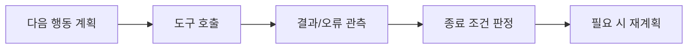

## LLM 앱과 에이전트 루프의 차이
- `LLM 앱`은 사용자의 요청에 대해 단발적인 응답만을 출력으로 내놓는다.
- `에이전트 루프`는 사용자가 요구한 목표를 달성하기 위해, 반복해서 작업을 수행한다.
	- 에이전트 루프의 최소 단위는 `계획 → 도구 호출 → 결과 관측 → 재계획`이다.
	- `도구 (Tool)`는 검색, DB 쿼리처럼 외부 서비스를 호출/수정 하는 것
		- 결과는 반드시 다음 턴으로 전달되어야한다.
	- 관찰 없이 계획만 반복하면, `환각 (Hallucination) 루프`가 되고, 
	  종료 조건이 없으면 LLM API 호출 비용이 폭증함.

- 에이전트 도입 하기 위해선, 아래 4가지를 체크한다.
	- 여러 정보/행동이 필요한가
	- 중간 결과로 분기가 필요한가
	- 오답/오행동 비용이 허용 범위인가
	- 예산 (토큰, 시간 등)을 숫자로 정할 수 있는가